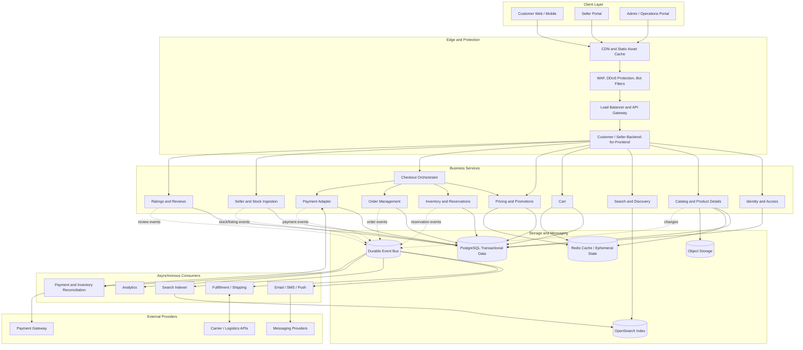
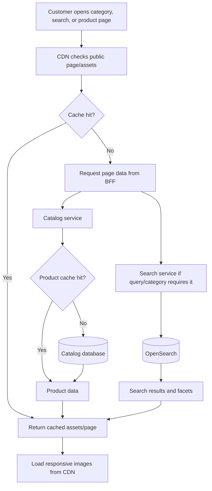
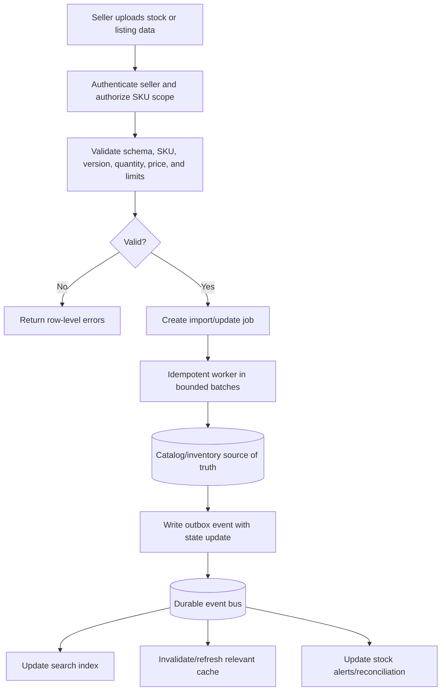
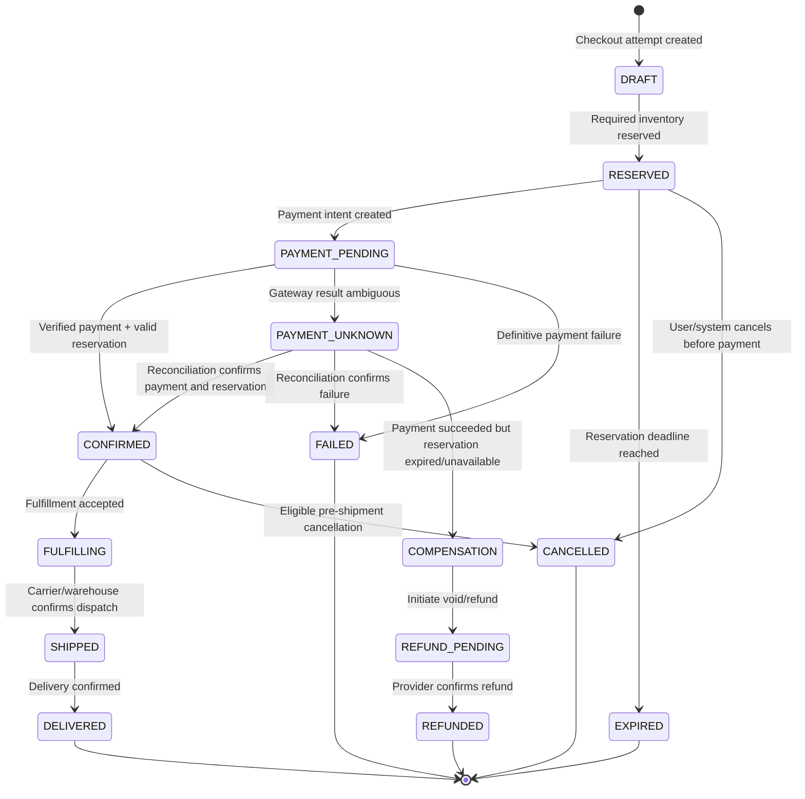
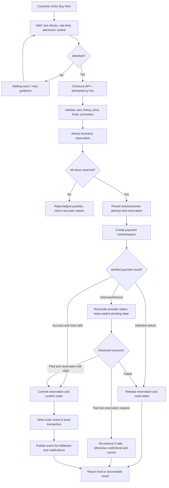
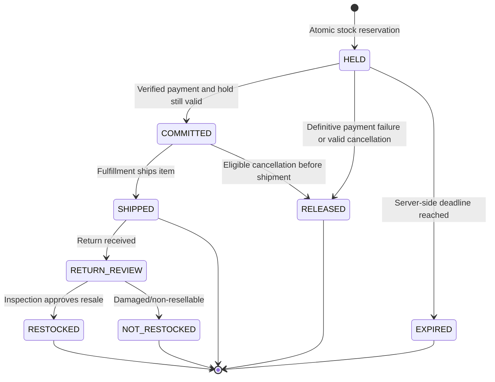
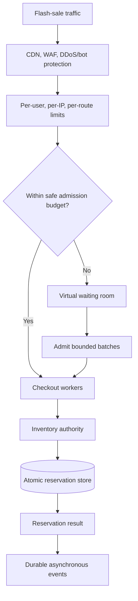
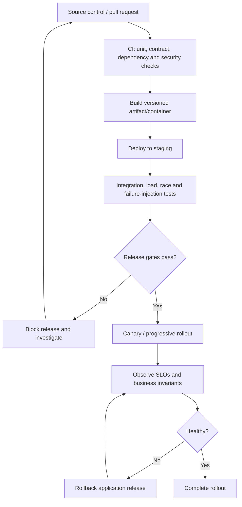

# Meesho-Style Scalable E-Commerce Platform

## Architecture, Data Flow, Security, Reliability, and Capacity Plan

**Document type:** Implementation-oriented system design blueprint  
**Scope:** Responsive e-commerce storefront, seller portal, product discovery, catalog, cart, inventory, flash-sale checkout with a three-minute reservation window, payment integration, orders, notifications, fulfillment, and operational resilience.  
**Status:** Reference architecture; concrete capacity numbers must be validated through workload measurement and load testing.

> This is a proposed architecture for a Meesho-style platform based on the provided case-study requirements. It does not claim to describe Meesho's internal production architecture.

---

## Table of contents

1. [Objectives and non-functional requirements](#1-objectives-and-non-functional-requirements)
2. [Recommended technology stack](#2-recommended-technology-stack)
3. [High-level architecture](#3-high-level-architecture)
4. [Component responsibilities and service boundaries](#4-component-responsibilities-and-service-boundaries)
5. [Core customer and seller flows](#5-core-customer-and-seller-flows)
6. [Flash-sale checkout and inventory correctness](#6-flash-sale-checkout-and-inventory-correctness)
7. [Data model and database design](#7-data-model-and-database-design)
8. [Demand spikes, hot products, and supply handling](#8-demand-spikes-hot-products-and-supply-handling)
9. [Latency, bandwidth, and caching](#9-latency-bandwidth-and-caching)
10. [Security and privacy](#10-security-and-privacy)
11. [Failure modes and edge cases](#11-failure-modes-and-edge-cases)
12. [Scalability and capacity planning](#12-scalability-and-capacity-planning)
13. [Observability, alerting, and recovery](#13-observability-alerting-and-recovery)
14. [Deployment and release architecture](#14-deployment-and-release-architecture)
15. [Implementation roadmap](#15-implementation-roadmap)
16. [Acceptance criteria and test plan](#16-acceptance-criteria-and-test-plan)
17. [Key decisions and unresolved questions](#17-key-decisions-and-unresolved-questions)

---

## 1. Objectives and non-functional requirements

### 1.1 Functional scope

The platform should support:

- Responsive customer web experience on desktop, tablet, and mobile.
- Seller portal for managing listings, product variants, prices, and inventory feeds.
- Product home page, categories, search, filters, sorting, and product detail pages.
- Product images, descriptions, pricing, ratings, and reviews.
- Cart management and checkout.
- Authentication, account ownership, and role-based authorization.
- Inventory validation and short-lived stock reservations.
- Payment gateway integration, payment status reconciliation, order creation, and refunds.
- Order status, notification, fulfillment, and shipping integrations.
- Flash-sale traffic handling with a **180-second (three-minute) reservation period**.
- Seller stock ingestion, cache/index updates, and operational monitoring.

### 1.2 Core system invariants

These are correctness rules, not optional performance optimizations.

1. **No overselling:** Sellable stock cannot be reserved or committed beyond the inventory authority's permitted quantity.
2. **Idempotent checkout:** Retrying a request must not create another order, reservation, or payment operation for the same logical attempt.
3. **Verified payment state:** A browser redirect or timeout is not sufficient proof of payment. Verify gateway responses/webhooks and reconcile uncertain outcomes.
4. **Reservation expiry is server-controlled:** The browser timer is only a display. Server-side state and timestamps determine expiration.
5. **Order history is stable:** Price, discount, tax, currency, shipping, and relevant product details are snapshotted at order time.
6. **Asynchronous side effects are durable:** Notifications, search indexing, and fulfillment events must survive a process crash after a database write.
7. **Authorization is resource-based:** A valid login does not grant access to every order, address, seller listing, or administrative operation.
8. **Graceful overload:** Nonessential features may degrade, but inventory correctness and payment verification must not be bypassed.

### 1.3 Proposed starting SLOs

These are starting targets for engineering and testing—not claims about an existing platform. Tune them after defining the expected geography, device mix, traffic, business impact, and cloud environment.

| Metric | Initial target | Measurement notes |
|---|---:|---|
| Cached product/category API latency | p95 ≤ 200 ms | Measure at the defined API boundary and from representative regions. |
| Search API latency | p95 ≤ 300 ms | Include filters, sorting, and realistic query distributions. |
| Internal reservation transaction | p95 ≤ 150 ms | Measure under the accepted load and contention profile. |
| Checkout service processing, excluding third-party payment time | p95 ≤ 500 ms | Define which internal steps are included. |
| Eligible static asset CDN hit ratio | ≥ 90% | Exclude uncached/private content from denominator. |
| Critical customer journey availability | Initial target ≥ 99.9% | Define monthly measurement and excluded maintenance, if any. |
| Inventory correctness | Zero oversells caused by concurrent reservation races | Test with many clients competing for the final units. |
| Duplicate checkout operations | Zero duplicate orders/payment intents for identical idempotency scope | Verify at API and provider boundaries. |

Latency should be reported at p50, p95, and p99. Averages alone hide tail latency.

---

## 2. Recommended technology stack

Technology selections below are reference choices. Use equivalent managed services when they satisfy consistency, security, operational, and cost needs.

| Layer | Reference option | Responsibility |
|---|---|---|
| Frontend | React + Next.js | Responsive UI, server rendering/SEO where useful, route-level code splitting. |
| Edge delivery | CDN, WAF, DDoS protection | Cache public assets, absorb common traffic, filter abusive requests. |
| API entry | Load balancer + API gateway | Routing, quotas, authentication enforcement, request size/time limits. |
| Backend | NestJS or Spring Boot | Modular business logic and APIs. |
| Primary transactional store | PostgreSQL | Orders, reservations, payment metadata, customer and seller records. |
| Cache / ephemeral state | Redis | Hot read cache, waiting-room tokens, rate-limit state, session acceleration. |
| Search | OpenSearch | Full-text search, faceted navigation, sorting, searchable projections. |
| Object storage | S3-compatible object storage | Original product media, import files, generated thumbnails, reports. |
| Event transport | Kafka or managed equivalent | Durable asynchronous events, consumer decoupling, replay. |
| Payment | External payment service provider | Payment authorization/capture, webhooks, voids, refunds. |
| Notifications | Email/SMS/push provider | Order and seller notifications. |
| Observability | OpenTelemetry + metrics/logs/traces backend | Cross-service diagnosis, SLO tracking, alerting. |
| Deployment | Containers + managed orchestration or platform service | Controlled rollout, health checks, horizontal scaling. |

### Architecture approach

Start with a **modular monolith** if the team or project is small. Keep modules, data ownership, API contracts, and transaction boundaries explicit. Split services or deploy independently only when scale, security isolation, team ownership, or release needs justify it.

Do not adopt microservices, Kafka, Kubernetes, sharding, or multi-region writes merely because the system is expected to scale. Each adds operational complexity. The minimum correct transactional core comes first.

---

## 3. High-level architecture



### 3.1 Design interpretation

- **Edge:** serves versioned media and static assets, filters attacks, and limits traffic before application resources are consumed.
- **BFF/API layer:** gives clients suitable response shapes and applies request-level validation. It must not own stock correctness or bypass domain services.
- **Business services:** own domain rules; inventory, order, and payment transitions require stronger consistency than product search.
- **Data:** PostgreSQL stores authoritative transactional state. Redis is a performance/ephemeral layer, OpenSearch is a derived search index, and object storage contains media/files.
- **Event consumers:** send notifications, update search projections, trigger fulfillment, and reconcile uncertain state asynchronously.

### 3.2 Data ownership map

| Data | Authoritative owner | Derived/cache copies |
|---|---|---|
| Listing title, description, seller ownership | Catalog | Redis, rendered pages, OpenSearch |
| Search ranking/indexed attributes | Search projection pipeline | OpenSearch |
| Sellable quantity and reservation lifecycle | Inventory | Redis/display indicators only |
| Promotion eligibility and current pricing rules | Pricing | Short-lived pricing cache |
| Order state and order-time price snapshot | Order Management | Private read models/cache |
| Payment state | Payment adapter reconciled against provider records | Read-only status cache |
| Review content and moderation status | Reviews | Cached aggregates/search projection |

**Never authorize a purchase using cached stock, a search document, or a product page's displayed quantity.**

---

## 4. Component responsibilities and service boundaries

### 4.1 Identity and access

- Authenticate customers and sellers.
- Issue/validate sessions or tokens.
- Support session revocation, credential recovery, and optional MFA.
- Enforce roles and resource ownership with domain services.
- Record security-sensitive actions in audit logs.

### 4.2 Catalog

- Manage product, variant, category, description, image metadata, and listing status.
- Validate seller ownership and catalog moderation state.
- Publish catalog-change events through a transactional outbox.
- Keep media files in object storage rather than relational rows, except metadata and URLs/keys.

### 4.3 Search and discovery

- Query OpenSearch for full-text matches, facets, sorting, and pagination.
- Work from a derived projection fed by durable events.
- Set query timeouts, page-size caps, field allowlists, and resource limits.
- Use bounded fallback behavior if search is unavailable; never replace a failed search cluster with unbounded database scans.

### 4.4 Cart

- Store intended SKUs and quantities, not guaranteed stock.
- Scope cart records to the customer/session.
- Validate quantity limits and listing eligibility.
- Revalidate price, promotion, delivery eligibility, and inventory during checkout.
- Avoid reserving inventory just because an item is in a normal long-lived cart.

### 4.5 Pricing and promotions

- Calculate totals on the server using authoritative price and promotion rules.
- Define rounding, currency, taxes, shipping, coupon limits, and promotion stacking explicitly.
- Use atomic redemption counters or transactional constraints for globally limited promotions.
- Snapshot relevant price components on the order.

### 4.6 Inventory and reservations

- Own on-hand, reserved, committed, safety-stock, and reservation state.
- Offer one authoritative path to reserve and release stock.
- Enforce conditional transitions and prevent double release/commit.
- Manage expiration and reconciliation jobs.
- Partition inventory by SKU/warehouse when justified, ensuring each sellable unit has one authoritative owner.

### 4.7 Checkout orchestrator

- Manage checkout attempt state and coordinate pricing, inventory, order, and payment operations.
- Accept and persist idempotency keys.
- Use explicit deadlines and state transitions.
- Coordinate a saga, not a distributed transaction that cannot be made atomic across services and the payment provider.
- Return a recoverable status for uncertain outcomes; never assume a timeout means payment failed.

### 4.8 Order management

- Own order state, item snapshots, address snapshots, and cancellation lifecycle.
- Reject invalid state transitions.
- Write event records in the same transaction as important state changes.
- Keep order confirmation separate from best-effort notifications.

### 4.9 Payment adapter

- Create payment intents/requests using provider idempotency support where available.
- Verify webhooks and reconcile amount, currency, provider reference, and order reference.
- Deduplicate events by provider event ID.
- Track `UNKNOWN`/`PROCESSING` states when outcomes are ambiguous.
- Support void/refund workflows and periodic reconciliation.
- Avoid storing raw card numbers or card security codes.

### 4.10 Seller ingestion

- Accept listing/stock changes and bulk import files.
- Validate schema, SKU identity, seller ownership, quantity and update version.
- Process big uploads asynchronously in bounded batches.
- Return an import job ID and row-level validation report.
- Avoid allowing seller feeds to overwrite reservations or confirmed orders.

### 4.11 Event consumers

- Notification consumer: retry provider failures without blocking orders.
- Fulfillment consumer: create shipping/warehouse work idempotently.
- Search indexer: update the derived search projection.
- Analytics consumer: aggregate events outside the critical transactional database.
- Reconciliation consumer: repair ambiguous payment/reservation/order states from authoritative records.

---

## 5. Core customer and seller flows

### 5.1 Product discovery



Search and catalog can tolerate bounded staleness. Checkout must revalidate listing status, actual price, promotion eligibility, and authoritative sellable inventory.

### 5.2 Add to cart

1. Authenticate the customer and validate cart ownership.
2. Confirm that the requested variant/listing exists and is eligible.
3. Validate quantity bounds and update cart state idempotently where practical.
4. Return indicative price and availability with appropriate freshness semantics.
5. At checkout, revalidate everything; do not treat the cart as a stock reservation.

### 5.3 Seller stock update



Use sequence/version protection to reject stale or out-of-order seller feeds. Define whether incoming stock means a physical count, a delta, or an externally reported availability quantity; these semantics must not be mixed. Reconcile physical stock and open reservations before accepting large authoritative count changes.

### 5.4 Normal order lifecycle



This is a conceptual state machine. Choose exact states, cancellation windows, payment capture timing, and refund rules based on the selected payment provider and fulfilment model.

---

## 6. Flash-sale checkout and inventory correctness

This is the highest-risk consistency area in the design.

### 6.1 Inventory vocabulary and invariant

For each SKU and warehouse, track these concepts:

- `on_hand`: physical quantity recorded for the location.
- `reserved`: quantity held by active checkout reservations.
- `committed`: quantity allocated to confirmed orders not yet shipped, if using this accounting model.
- `safety_stock`: quantity excluded from sale.

A conceptual available quantity is:

`available = on_hand - reserved - committed - safety_stock`

The exact schema may instead store an `available` counter plus ledger/history records, but every update must preserve one consistent accounting model. Do not decrement `available` and also subtract the same reservation elsewhere in a way that double-counts it.

### 6.2 Checkout flow



### 6.3 Atomic reservation

A simple conditional update illustrates the core rule:

```sql
UPDATE inventory
SET available = available - :quantity,
    reserved  = reserved + :quantity
WHERE sku = :sku
  AND warehouse_id = :warehouse_id
  AND available >= :quantity;
```

The application must verify the affected row count. One row means the conditional decrement succeeded; zero rows means the reservation was not granted. This snippet is **not** a complete production transaction.

In production, the transaction must also:

1. Check SKU/warehouse eligibility and quantity limits.
2. Enforce idempotency for the checkout attempt.
3. Change inventory accounting atomically.
4. Insert a reservation and reservation-item records.
5. Set an authoritative expiration timestamp.
6. Commit all related writes together.
7. Return the stored result on a duplicate request with the same idempotency key.

For several SKUs sharing one transactional boundary, reserve all required lines atomically where feasible. Lock rows in deterministic order to reduce deadlocks. If inventory resides in separate transactional partitions, use a saga: reserve lines independently and compensate by releasing already-held lines if any required line fails.

### 6.4 Reservation lifecycle



All state-changing operations must be guarded, for example `UPDATE ... WHERE status = 'HELD'`. This prevents expiration and confirmation from both winning. Reservation status changes and inventory counter changes must be in the same local transaction.

### 6.5 Three-minute deadline policy

Set `expires_at = reservation_created_at + 180 seconds` using server-side time. The browser countdown is only informational.

Recommended rules:

- A periodic worker scans expired holds in indexed, bounded batches.
- The expiration worker attempts a guarded `HELD -> EXPIRED` transition.
- Before releasing inventory for an ambiguous payment, reconcile payment status or wait for a clearly defined, bounded grace policy.
- If payment definitively failed, release stock and record the outcome.
- If payment succeeded while the hold remains valid, commit reservation and confirm order.
- If payment succeeds after the hold expired, do not confirm unless inventory can be safely reserved again. Otherwise void/refund and cancel.
- A payment uncertainty grace window must be finite, explicitly documented, and must not silently turn a 180-second reservation into an unlimited hold.
- Monitor the age and count of expired-but-not-processed reservations.

### 6.6 Payment saga and reconciliation

A transaction cannot atomically cover PostgreSQL, Redis, a message broker, and an external payment provider. Use a saga with durable state and compensating actions.

| Situation | Required handling |
|---|---|
| Payment accepted normally | Verify provider result, commit reservation, confirm order. |
| Payment declined | Release hold and mark payment failed. |
| Provider timeout | Mark `UNKNOWN`/`PROCESSING`; query provider or await verified webhook. |
| Client retries payment creation | Reuse idempotency scope; do not create a duplicate intent. |
| Duplicate webhook | Deduplicate provider event ID and apply guarded state transition. |
| Webhook beats browser response | Process verified webhook independently of browser timing. |
| Payment success after reservation expiration | Safely re-reserve if possible; otherwise void/refund and cancel. |
| Database failure after provider success | Reconcile and retry durable finalization. |
| Refund timeout | Track `REFUND_PENDING`; query provider status before retrying. |
| Delayed stale event | Never regress a verified terminal state to a less advanced state. |

Verify webhook signature, provider event identity/replay protection where supported, amount, currency, order reference, and transaction reference. Do not infer payment success from the customer returning to a success URL.

### 6.7 Transactional outbox

1. In one database transaction, write the business-state change and an outbox event.
2. A publisher reads unprocessed outbox rows and publishes them to the broker.
3. Mark published only after broker acknowledgement.
4. Consumers deduplicate by stable event ID and apply state changes idempotently.
5. Alert on old, repeatedly failing, or growing outbox backlogs.

Design consumers for **at-least-once delivery**. Do not assume exactly-once behavior across a database and a broker.

---

## 7. Data model and database design

### 7.1 Suggested entities

| Entity | Important fields / constraints |
|---|---|
| `users` | `user_id`, identity reference, status, created/updated timestamps. |
| `seller_accounts` | `seller_id`, owner reference, verification status, permissions. |
| `products` | `product_id`, seller, title, description, category, listing status. |
| `product_variants` | SKU, product, variant attributes, price reference, status. |
| `inventory` | SKU, warehouse, on-hand/reserved/committed or a consistent available-counter model, safety stock, version. |
| `stock_reservations` | Reservation ID, checkout ID, status, `expires_at`, idempotency scope. |
| `reservation_items` | Reservation ID, SKU, warehouse, quantity. |
| `carts` / `cart_items` | Cart ID, owner/session scope, SKU, quantity, updated time. |
| `orders` | Order ID, customer, state, total snapshot, currency, address snapshot, idempotency key. |
| `order_items` | Order ID, SKU, quantity, unit-price/discount/tax snapshot. |
| `payments` | Payment ID, order ID, provider reference, amount, currency, status. |
| `webhook_events` | Provider name, unique provider event ID, receive time, processing state. |
| `outbox_events` | Event ID, aggregate ID, event type, payload, creation/publish state. |
| `seller_import_jobs` | Job ID, seller, status, progress, error report reference. |
| `reviews` | Review ID, user, product, rating, moderation status. |

### 7.2 Important constraints and indexes

- Unique idempotency key within a clearly defined owner/endpoint scope.
- Unique provider event ID within provider namespace.
- Unique provider payment reference where appropriate.
- Index inventory by `(sku, warehouse_id)` with a unique constraint if the model permits one row per SKU/location.
- Index held reservations by status and expiry time for batch expiry processing.
- Index orders by customer and created time for account history.
- Index outbox records by publication state and creation time.
- Index seller import jobs by seller and creation time.
- Use foreign keys and check constraints for values that can be reliably enforced locally.
- Use optimistic version columns or conditional writes for competing updates where useful.

### 7.3 Transaction boundaries

**Inventory transaction:** validate eligibility, conditionally reserve stock, create reservation records, set expiration, and commit together.

**Order transaction:** create or retrieve the idempotent attempt, record immutable item/price snapshots, update order state, and create an outbox event together.

**Payment transaction:** store provider references and event-processing state; validate callbacks idempotently and publish a durable event.

The checkout orchestrator coordinates these local transactions. Do not pretend a single ACID transaction spans all services and providers.

### 7.4 Scaling the data tier

- Begin with indexed PostgreSQL and benchmark before adding sharding.
- Use read replicas only for appropriate reads; replication lag means they cannot authorize stock reservations.
- Apply bounded connection pools; use a pooler if suitable.
- Prefer keyset pagination for deep result sets over large offsets.
- Partition or archive high-volume historical data when operational evidence supports it.
- Keep analytical workloads out of checkout's primary resource budget.
- Monitor slow SQL, lock waits, deadlocks, pool saturation, replication lag, and storage growth.
- Keep cache invalidation event-driven with a finite TTL as a safety net.

---

## 8. Demand spikes, hot products, and supply handling

### 8.1 Demand admission flow



The admission budget must reflect **measured safe throughput of the bottleneck**, especially the inventory database and payment provider. Increasing application pods while the database or provider is saturated makes the overload worse.

### 8.2 Hot-SKU options

| Technique | Suitable use | Limitation / guardrail |
|---|---|---|
| Conditional atomic database updates | Baseline implementation | A very popular row can become a lock hotspot. |
| SKU-keyed queue/serialized processing | Extremely contested SKU | Throughput per hot SKU depends on queue processing capacity. |
| Bounded waiting room/admission | Campaign bursts | Requires clear position/eligibility semantics and fairness policy. |
| Inventory partitioning by SKU/warehouse | Larger scale with stable ownership | Routing and failover must preserve unique ownership of each unit. |
| Preallocated quotas | Huge events where quotas can be safely divided | Sum of quotas must never exceed sale quantity; rebalancing needs safe ownership transfer. |
| Approximate display counter | Fast customer-facing indication | Never use it to grant inventory. |

### 8.3 Safe quota approach

If a sale offers 10,000 units, the sum of all region/partition quotas must be at most 10,000. Each quota owner atomically consumes its allocation. If a partition fails, some stock may temporarily remain unsold; this is safer than allowing two owners to sell the same units. Rebalance only using an acknowledged transfer that prevents double ownership.

### 8.4 Separate critical demand and supply work

- **Demand path:** browse, search, cart, reservation, checkout, payment.
- **Supply path:** seller listing edits, inventory feeds, bulk imports, price updates, catalog moderation, warehouse updates.
- **Background path:** search indexing, notifications, recommendations, analytics, scheduled reconciliation.

Use separate worker pools, resource budgets, queue limits, and database write policies where feasible. During a flash sale, pause or slow bulk imports and nonessential indexing if they threaten checkout SLOs. Seller stock changes still require a defined correctness and freshness policy.

### 8.5 Queue protections

- Bound queue depth and consumer concurrency.
- Apply per-tenant quotas so one seller or campaign cannot monopolize resources.
- Use retry backoff and jitter; avoid synchronized retry storms.
- Route poison messages to a dead-letter queue with replay tooling.
- Expose queue age and depth as well as consumer lag.
- Do not retry permanently invalid messages endlessly.
- Use load shedding when downstream capacity is exhausted.

---

## 9. Latency, bandwidth, and caching

### 9.1 Frontend and network optimizations

| Problem | Implementation |
|---|---|
| Large product image payload | Store originals in object storage; generate AVIF/WebP and responsive sizes; deliver via CDN. |
| Too much JavaScript | Route-level code splitting, lazy loading, remove unused libraries, defer nonessential scripts. |
| Slow first render | Use SSR/static generation when appropriate, critical CSS, measured preload hints, skeletons that do not shift layout. |
| Excessive API requests | BFF aggregation, request deduplication, suitable batching, avoid repeated polling. |
| Weak mobile networks | Small payloads, pagination, explicit timeouts, bounded retries with backoff/jitter, useful error states. |
| Huge search responses | Field allowlists, capped result page size, cursor/keyset pagination where supported. |
| Many offscreen images | Lazy-load below-the-fold images and reserve aspect ratios. |
| Connection overhead | Reuse connections and enable HTTP/2/HTTP/3 where supported and beneficial. |

### 9.2 Cache policy by data type

| Data | Cache policy |
|---|---|
| Versioned JS/CSS/static assets | Long-lived immutable caching. |
| Public category pages/listings | Short-lived edge cache if content is public and freshness requirements permit it. |
| Product detail data | Short-lived app cache with event-driven invalidation and TTL backstop. |
| Search queries | Short-lived cache for popular, safe-to-cache query combinations. |
| Displayed stock estimate | Short-lived and explicitly approximate. |
| Cart | Private, owner-scoped; never shared at CDN level. |
| Order/payment status | Authoritative read or properly refreshed private projection. |
| Reservation grant | Never authorize from cache; require authoritative transaction. |

Never accidentally cache private addresses, carts, account details, or order states as public content. Carefully define cache keys, `Cache-Control`, and authenticated request behavior.

### 9.3 Low-latency techniques that can backfire

- **Unbounded concurrency:** lowers latency briefly but can exhaust database connections and memory.
- **Retries at every layer:** multiply requests during a failure; use bounded, coordinated retries.
- **Stale-while-revalidate for stock decisions:** acceptable for display only, not for reservations.
- **Very long caches:** improve hit rate but increase stale prices/listing data; pair invalidation with TTL.
- **More application replicas:** not useful if a single database row or payment-provider quota is the actual bottleneck.
- **Synchronous side effects:** sending SMS or updating search within checkout increases latency and couples availability unnecessarily.

---

## 10. Security and privacy

### 10.1 Threat/control matrix

| Risk | Controls |
|---|---|
| Account takeover | Suitable password hashing or managed identity, rate-limited login, MFA option, credential recovery protection. |
| Session theft | HTTPS, Secure/HttpOnly cookies, appropriate SameSite, rotation/revocation/expiry. |
| IDOR / broken access control | Check ownership/authorization for every private resource and action. |
| Injection and malformed input | Schema validation, parameterized SQL, output encoding, safe templates, security headers, CSP. |
| CSRF | CSRF protections where cookie-based authentication and request semantics require them. |
| Seller abuse | MFA for privileged accounts, seller-scoped access, audit trail, rate and quantity limits. |
| Flash-sale bots | Risk-based bot detection, per-account caps, waiting-room controls, anomaly analysis. |
| Inventory/price tampering | Server-side price/promotion calculation and inventory-owned reservation APIs. |
| Malicious uploads | Size/type/content validation, isolated transformation, malware scanning where appropriate, no executable public uploads. |
| Spoofed/replayed payment webhook | Signature validation, provider-event dedupe, replay safeguards, amount/currency/order verification. |
| Secret leakage | Secret manager, rotation, no secrets in source, client bundles, logs, URLs, or error pages. |
| Database compromise | Private network, least privilege, encryption at rest, managed keys, patching, backup/restore tests. |
| DDoS/application floods | Upstream DDoS protection, WAF, endpoint budgets, request/concurrency limits, controlled admission. |
| Insider misuse | Separation of duties, audited privileged access, alerts for sensitive operations. |

### 10.2 Authorization model

Suggested roles include customer, seller, support agent, fulfillment operator, and administrator. Use least privilege. A customer can access only their private records; a seller can manage only permitted seller resources. Support/admin operations should be separated and audited. Do not rely only on a client-supplied role, SKU, order ID, or seller ID.

### 10.3 Network architecture

- Public exposure should normally end at CDN/WAF/gateway-approved entry points.
- Databases, cache, and brokers should be reachable only through private network paths.
- Use TLS externally and service authentication internally; consider mTLS for sensitive service-to-service paths.
- Set per-call deadlines and propagate request deadlines.
- Apply circuit breakers and controlled fallback to failing dependencies.
- Keep network policies and security groups minimal and auditable.

### 10.4 Payment and privacy

Prefer hosted or tokenized payment components so raw card numbers and security codes are not stored by the platform. Determine applicable PCI DSS and local privacy requirements from the exact integration, data flows, and jurisdictions. Minimize the personal data stored and logged. Redact tokens, authentication material, payment data, and unnecessary personal information from observability systems.

---

## 11. Failure modes and edge cases

Every row should have a test case, expected customer behavior, state transition, metric, and recovery mechanism.

### 11.1 Catalog and seller

| Edge case | Expected handling |
|---|---|
| Product deactivated after cart addition | Reject checkout for the inactive listing; preserve cart where practical and explain. |
| Seller or listing suspended | Authoritative listing eligibility blocks new orders. |
| Duplicate SKU in upload | Reject or idempotently update under an explicit SKU ownership policy. |
| Price changes after cart add | Recalculate server-side; show changed total and require renewed confirmation when necessary. |
| Coupon expires mid-checkout | Revalidate, recalculate, and return a clear pricing result. |
| Concurrent redemption of limited coupon | Atomic cap enforcement prevents exceeding the promotion limit. |
| Partial failure in bulk upload | Process valid rows only if import contract allows it; provide row-level errors and resumable job. |
| Seller updates out of order | Use monotonic version/sequence semantics and reject stale updates. |
| Stale seller feed | Mark freshness, alert, and reconcile; do not silently assume current stock. |
| Corrupt image or media service down | Placeholder and asynchronous retry; catalog/checkouts remain available. |

### 11.2 Inventory and orders

| Edge case | Expected handling |
|---|---|
| Two users request final unit | Exactly one reservation succeeds. |
| Quantity exceeds availability | Reject or propose smaller quantity from an authoritative result. |
| Multi-SKU cart has one unavailable line | Roll back local transaction or compensate prior reservations. |
| Request repeated after timeout | Return stored outcome using same idempotency key. |
| Expiration races confirmation | Guarded state transition; one transition wins. |
| Browser closes during checkout | Server-side expiry releases the hold without requiring browser callback. |
| Inventory DB unavailable | Fail closed for new holds; do not assume availability. |
| Cache says stock exists but DB says zero | Inventory authority wins; reject. |
| Physical count lower than reservations/commitments | Stop new sales as needed; reconcile and explicitly resolve affected orders. |
| Warehouse allocation fails | Use another eligible warehouse only under defined shipping/stock rules; otherwise compensate. |
| Cancellation before shipment | Release committed stock once through an idempotent workflow. |
| Return is damaged | Do not restock until inspection approves resale. |

### 11.3 Payment and infrastructure

| Edge case | Expected handling |
|---|---|
| Payment gateway slow | Bounded processing state; no duplicate payment creation on retry. |
| Payment succeeds but callback is late | Reconcile provider state and resume finalization. |
| Stale webhook after success | Do not regress terminal/verified state. |
| Notification provider down | Retry asynchronously; order remains confirmed. |
| Broker or consumer unavailable | Outbox stores pending events; alert on backlog and resume later. |
| DB primary failover | Follow consistency guarantees; resolve ambiguous in-flight writes instead of assuming success. |
| Redis down | Safe degraded reads where possible; fallback must not overload the database. |
| Search unavailable | Bounded fallback or retry response; avoid unbounded direct DB search. |
| Downstream dependency fails | Deadlines, circuit breakers, controlled load shedding. |
| Client disconnects after submitting order | Same idempotency key recovers existing checkout result. |
| Queue depth explodes | Slow admissions, show queue state, cap work and preserve core services. |
| Cloud region unavailable | Use rehearsed recovery/traffic-routing plan; do not promote stale inventory as authoritative without safe failover. |

### 11.4 Global degraded-mode rule

If a consistency-sensitive dependency is unavailable, report a temporary failure or uncertain state rather than inventing success. An unavailable reservation authority cannot imply that stock was reserved. A payment timeout cannot be interpreted as either confirmed payment or confirmed failure until reconciled.

---

## 12. Scalability and capacity planning

### 12.1 Basic estimates

Let:

- `D` = daily active users.
- `R` = average requests per user per day.
- `P` = peak multiplier over average request rate.

Then:

`Average RPS = (D × R) / 86,400`

`Estimated Peak RPS = Average RPS × P`

This is a rough estimate only. Page-level request fanout, cache hits, bots, campaign bursts, retries, and geographical traffic patterns can materially change actual load.

For reservations, Little's Law gives a useful steady-state approximation:

`Outstanding holds ≈ successful reservations per second × average hold duration in seconds`

For example, 100 successful reservations/s with a mean 180-second hold gives approximately 18,000 outstanding holds under steady conditions. This is an illustrative planning example, not a traffic forecast. Payment delays and expired-hold worker lag can increase actual backlog.

### 12.2 Scaling by component

| Component | Scaling strategy | Bottleneck signals |
|---|---|---|
| Static/media delivery | CDN and responsive formats | Cache misses, origin egress, image transformation queue. |
| Stateless APIs | Horizontal autoscaling with max concurrency | CPU/memory, in-flight requests, latency, errors. |
| Catalog | Read caches, indexes, efficient queries | Cache miss rate, query latency, DB reads. |
| Search | Tune shards/indexes, scale search capacity | Query p95/p99, heap, shard pressure, indexing backlog. |
| Inventory | Conditional writes, admission control, hot-SKU strategy | Lock wait, transaction latency, reservation conflicts. |
| Orders/payments | Bound workers and pool sizes; idempotent retries | DB write pressure, provider limits, pending states. |
| Event consumers | Scale within partition and downstream limits | Consumer lag, event age, retry count. |
| Seller imports | Asynchronous, bounded batches and per-seller quotas | Import backlog, DB write contention. |
| Analytics | Separate analytical store/workers | Resource contention with transactions. |

### 12.3 Load test matrix

| Test scenario | What it validates |
|---|---|
| Browse-heavy traffic | CDN/cache effectiveness and catalog read capacity. |
| Search-heavy traffic | Search latency, facets, sorts, resource caps. |
| High cart-update traffic | Cart data tier and request efficiency. |
| Last-unit contention | No oversell; lock behavior and reservation throughput. |
| Flash sale for one SKU | Hot-row contention and admission behavior. |
| Multi-SKU checkout | Deadlocks, rollback/compensation, all-or-none semantics. |
| Slow payment gateway | Pending holds, duplicate retries, reconciliation correctness. |
| Seller bulk import during sale | Isolation of supply workload from checkout. |
| Cache cold-start | Database protection during high cache-miss rate. |
| Node/DB failover | In-flight request recovery and consistency. |
| Queue backlog recovery | Catch-up speed without another traffic spike. |
| Poor mobile network | Usability under high RTT, bandwidth limits, and dropped connections. |

### 12.4 Autoscaling guardrails

Do not scale based on CPU alone. Consider latency, queue depth/age, concurrency, errors, DB connection usage, and downstream saturation. Define upper bounds on workers and connection pools. If a downstream is saturated, slow admission or shed nonessential work rather than letting upstream concurrency grow indefinitely.

---

## 13. Observability, alerting, and recovery

### 13.1 Correlation

Propagate a trace/request ID across the BFF, checkout, inventory, order, payment, and event consumers. Include logical order, reservation, payment, and event IDs in structured logs when safe. Never use sensitive personal data or secrets as correlation IDs.

### 13.2 Dashboard groups

**Customer experience**
- Page load metrics and Core Web Vitals where available.
- API p50/p95/p99 latency and error rates.
- Search failure rate and result-empty anomalies.
- Cart-to-checkout and checkout-completion funnels.

**Inventory correctness**
- Reservation success/failure rate.
- Reservation transaction and lock-wait latency.
- Holds past deadline and expiry-worker backlog.
- Negative/inconsistent availability invariant violations.
- Physical-versus-logical stock discrepancies.

**Orders and payments**
- Payment success, failure, pending, and unknown rates.
- Gateway timeouts and webhook lag.
- Duplicate webhook suppression.
- Confirmed payments without confirmed orders.
- Refund backlog and age.

**Infrastructure and asynchronous work**
- Database CPU, connections, query latency, lock waits, and replication lag.
- Redis memory/evictions and hit ratio.
- Search latency and indexing backlog.
- Event queue depth, consumer lag, dead-letter growth.
- Oldest outbox record and publish failures.
- Backup and restore-test status.

### 13.3 High-priority alerts

- Any inventory invariant violation.
- Payment success without corresponding order finalization beyond a defined short threshold.
- Held reservations past the allowed deadline.
- Growing reconciliation/refund backlog.
- Checkout SLO breach or high error rate.
- Event/outbox backlog threatening fulfillment SLAs.
- Failed backup or restore verification.
- Abnormal account takeover, bot, or privileged-action signals.

### 13.4 Recovery mechanisms

- Use retries only for transient failures and idempotent actions, with exponential backoff and jitter.
- Send repeatedly failing messages to a dead-letter queue with auditable replay tooling.
- Enable backups and point-in-time recovery where supported; regularly test restoration.
- Document incident playbooks for provider outage, oversell risk, payment reconciliation, queue backlog, database failover, and flash-sale overload.
- Degrade recommendations, analytics, and other noncritical functionality first.
- Never disable inventory validation or payment verification to improve apparent availability.

---

## 14. Deployment and release architecture



### 14.1 Environment layout

- Separate development, test, staging, and production environments.
- Do not reuse production secrets or unrestricted production data in test environments.
- Keep database/cache/broker in private networks.
- Run application instances across multiple availability zones where supported.
- Keep production configuration in a managed configuration/secret system.
- Use infrastructure as code and review access/network changes.
- Configure health checks, graceful shutdown, and bounded autoscaling.

### 14.2 Safe schema migrations

Use expand-and-contract migrations:

1. Add backward-compatible schema fields or tables.
2. Deploy code compatible with both old and new schema.
3. Backfill/migrate data in bounded batches.
4. Switch reads/writes after verification.
5. Remove obsolete schema only after incompatible application versions are gone.

A normal application rollback must not assume that a destructive database migration can be undone automatically.

### 14.3 Resilience and region strategy

Start with a tested multi-availability-zone architecture if supported. Multi-region active-active inventory writes are significantly more complex because two regions must not sell the same last unit. If multi-region service is required, assign clear single-writer ownership per SKU/warehouse or use a rigorously designed globally coordinated allocation protocol. Define and test recovery point/time objectives before claiming disaster-recovery readiness.

---

## 15. Implementation roadmap

### Phase 1 — Functional foundation

**Build:** customer/seller UI, catalog, product variants, search, cart, authentication, PostgreSQL, media storage/CDN, payment integration, order management. Keep domain module boundaries even if deploying one backend.

**Exit criteria:** Core journeys work end-to-end; access control and server-side price calculation are tested; order records persist correctly.

### Phase 2 — Transactional correctness

**Build:** atomic stock reservation, 180-second expiration, checkout idempotency, state machines, payment reconciliation, saga compensation, transactional outbox, expiration worker.

**Exit criteria:** Race tests show no overselling; repeated requests do not duplicate orders/payments; late/ambiguous payment behavior is tested.

### Phase 3 — Read performance and asynchronous work

**Build:** Redis cache, search index, async notifications, fulfillment consumers, bounded seller imports, CDN image variants, database/index tuning, connection pooling.

**Exit criteria:** Workload tests meet the selected latency/error targets and cache cold-starts do not overwhelm the database.

### Phase 4 — Campaign and scale controls

**Build:** waiting room, admission limits, bot controls, purchase caps, bounded queues, autoscaling, hot-SKU queue or quota strategy if needed.

**Exit criteria:** Platform degrades gracefully at peak load; the last-unit test passes; recovery does not create a second overload event.

### Phase 5 — Production hardening

**Build:** security review, failure injection, restore tests, dashboards/alerts, incident playbooks, reconciliation tools, deployment automation, service decomposition only where justified.

**Exit criteria:** Recovery targets are tested; payment/inventory/order reconciliation is operational; alerts are actionable; releases can be rolled back safely.

---

## 16. Acceptance criteria and test plan

Use these as a project completion checklist. Add numeric thresholds for the actual planned traffic before production sign-off.

### Functional acceptance

- [ ] Customer can browse, search, filter, view product details and reviews.
- [ ] Seller can create/update listing and upload a validated stock feed.
- [ ] Cart updates are isolated to the correct customer.
- [ ] Checkout recalculates price and revalidates promotion and product state.
- [ ] Order history uses stable price/address snapshots.
- [ ] Notification and fulfillment processing can retry independently of checkout.

### Inventory and payment correctness

- [ ] Hundreds/thousands of concurrent attempts for one remaining unit produce at most one successful reservation.
- [ ] Multi-SKU checkout behavior is all-or-none within a single transaction boundary, or compensates safely across boundaries.
- [ ] Same idempotency key returns the original outcome after a dropped connection.
- [ ] Expiration and confirmation race tests prove only one guarded transition wins.
- [ ] A browser timeout does not cause duplicate payment intents.
- [ ] A duplicate webhook does not double-capture, duplicate-confirm, or double-refund.
- [ ] Payment success after expiry is either safely re-reserved or compensated with cancellation/void/refund.
- [ ] Stale payment events cannot regress a verified terminal state.
- [ ] A database crash between core write and event publishing is recovered through the outbox.

### Performance and overload

- [ ] p50/p95/p99 latency and error rate are measured at expected and peak load.
- [ ] Flash-sale admission is bounded by measured downstream capacity.
- [ ] Search and CDN degradation do not create unbounded database fallback load.
- [ ] Seller imports cannot monopolize checkout capacity.
- [ ] Redis loss has a tested, database-protective fallback strategy.
- [ ] Queue backlog recovery is load-tested.
- [ ] Mobile tests cover high RTT, low bandwidth and request interruption.

### Security and operations

- [ ] IDOR/resource-ownership tests cover orders, addresses, carts, and seller listings.
- [ ] Rate limits and bot controls are tested against realistic abusive traffic.
- [ ] Payment webhooks reject invalid signatures and mismatched amounts/references.
- [ ] Secrets and sensitive data do not appear in logs or client bundles.
- [ ] Backups are restored in a test environment and recovery results recorded.
- [ ] Runbooks exist for payment outage, inventory risk, queue backlog, and failover.
- [ ] Release rollback and backward-compatible migration procedures are exercised.

---

## 17. Key decisions and unresolved questions

Resolve these before production sizing; they materially affect the design.

1. **Expected demand:** average and peak RPS, daily active customers, checkout attempts per second, flash-sale traffic shape, and number of concurrent sellers.
2. **Inventory model:** single warehouse vs multi-warehouse, physical stock feeds vs deltas, safety-stock rules, reservation ownership, and acceptable stock staleness.
3. **Payment model:** authorize/capture timing, provider idempotency capabilities, webhook guarantees, provider query APIs, and refund/void timelines.
4. **Three-minute rule:** does the deadline apply to completing payment initiation, receiving verified payment success, or both? Define the bounded ambiguous-payment grace policy and customer message.
5. **Fairness:** queue ordering, purchase caps per account/address/payment method, anti-bot challenge policy, and treatment of reconnecting customers.
6. **Availability targets:** required uptime, recovery time objective (RTO), recovery point objective (RPO), and acceptable degraded modes.
7. **Data retention:** order, payment, audit, log and import-file retention; privacy and regulatory requirements.
8. **Geography:** user regions, legal/data residency constraints, primary deployment region, and CDN reach.
9. **Scale milestones:** triggers that justify splitting a module, introducing SKU-keyed queues, sharding, or multi-region architecture.
10. **Cost envelope:** managed service costs, CDN egress, search infrastructure, event volume, observability retention, and peak-versus-idle capacity.

---

## Final recommendation

Build a **transactionally correct commerce core** first: inventory-owned atomic reservations, idempotent checkout, explicit payment/order state machines, and durable event publication. Place it behind a protected edge and bounded admission system. Use CDN/cache/search for read scalability and a durable event bus for work that does not need to block checkout. Isolate seller bulk operations and analytics from the critical write path.

Scale only after load tests identify the bottleneck. For a flash sale, a safe rejection or waiting room is preferable to overselling. When payment status is uncertain, reconcile it instead of guessing. When stock is uncertain, fail closed. Those choices preserve customer trust while keeping the system recoverable under heavy load.
